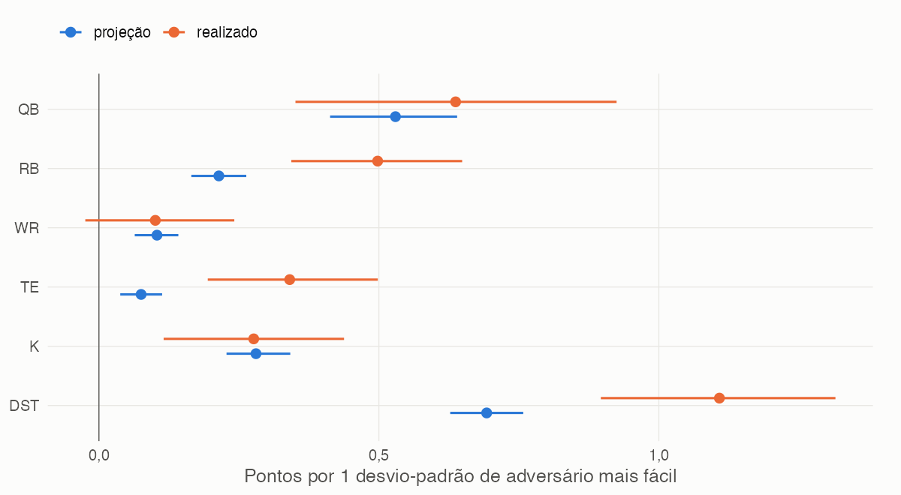
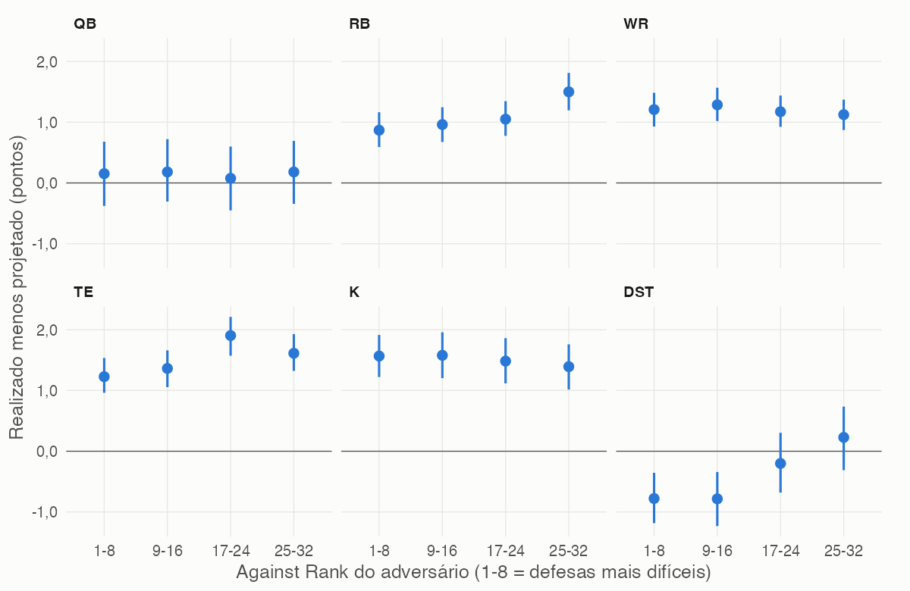
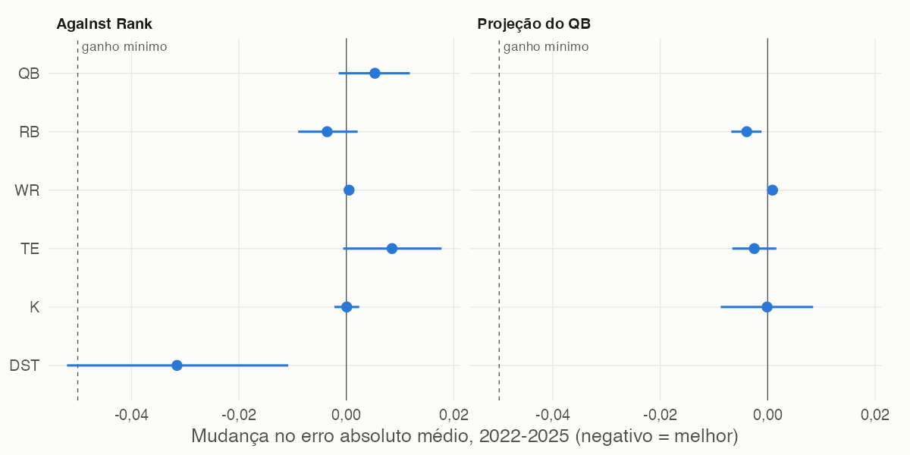
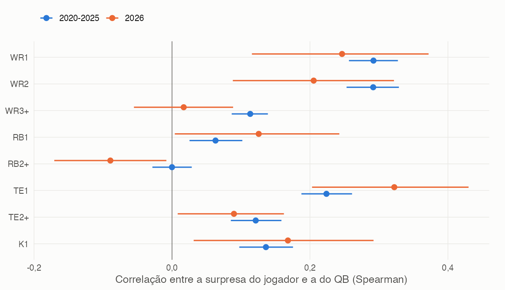
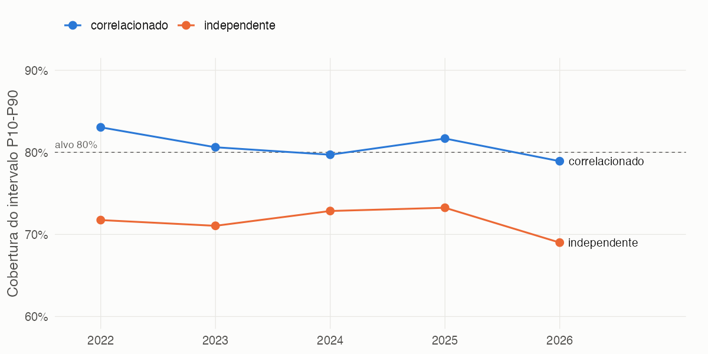

# Against Rank e QB: eles explicam o erro das projeções?

Análise de 2026-11-06, com dados até a semana 8 de 2026. Scripts em
`R/snippets/analysis_matchup_panel.R`, `analysis_against_rank.R` e
`analysis_qb_influence.R`.

## Resumo

O adversário e o QB influenciam os pontos, mas as projeções já incorporam a maior
parte disso. O que sobra é pequeno demais para melhorar projeções. Só um achado
melhora a simulação: a surpresa do jogador anda junto com a surpresa do QB dele, e
o motor hoje ignora isso. Mesmo assim, o efeito na liga real é quase nulo.

| Fator | Influencia o erro da projeção? | Melhora fora da amostra? | Decisão |
|---|---|---|---|
| Against Rank na projeção | Pouco: RB +0,23, TE +0,22 e DST +0,67 ponto por desvio-padrão de adversário mais fácil | Não. Melhor caso é DST, com erro absoluto 0,032 menor, abaixo do mínimo de 0,05 | Não usar |
| Qualidade do QB na projeção | Pouco: RB +0,19 e TE +0,16 ponto por desvio-padrão de QB melhor | Não. Melhor caso é RB, com erro 0,004 menor | Não usar |
| QB reserva como titular | Exploratório: WR −0,40 ponto | Não. O intervalo do erro absoluto cruza zero e o RMSE piora | Não usar |
| Correlação com o QB na simulação | Sim: 0,29 para WR1 e WR2, 0,22 para TE1 | Sim na soma QB + WR1 + TE1: cobertura de 72% para 81% e, em 2026, de 69% para 79% | Passa na regra, mas é baixa prioridade |

A pergunta testada não foi "o adversário afeta os pontos?", porque as fontes de
projeção já consideram isso. Foi: **depois da projeção, sobra efeito que possa ser
aproveitado?** Por isso o alvo é o resíduo (realizado menos projetado), e a decisão
vem de teste fora da amostra.

## Dados e método

- **Amostra:** 38.795 jogador-semanas, sendo 34.774 de 2020–2025 e 4.021 de 2026
  (W1–W8). A amostra principal do Against Rank usa semana ≥ 4: 30.801 linhas.
- **Time, adversário e QB titular:** vêm do `nflreadr`, porque o histórico local não
  tem essas informações. Em 2026 vêm do `espn_db`.
- **Against Rank:** reconstruído como pontos cedidos por jogo à posição, usando só
  semanas anteriores. Reproduz o rank real da ESPN em 2026 (Spearman ≥ 0,997) e o da
  NFL.com em 2025 (0,98). Rank 1 é a defesa mais difícil; 32, a mais fácil.
- **QB esperado:** o QB mais projetado do time, entre todos os projetados, para não
  usar a informação de quem de fato jogou. Ele foi o titular real em 85–97% dos jogos.
- **Incerteza:** bootstrap por bloco de time-jogo, pois jogadores do mesmo time na
  mesma partida não são observações independentes. Holm corrige os testes primários.
- **Fora da amostra:** o efeito é estimado nas temporadas anteriores e aplicado na
  seguinte (2022–2025). Depois é estimado em 2020–2025 e aplicado em 2026.

**Regra de adoção, definida antes dos resultados.** Por posição, todas as condições:

1. Intervalo de 95% da mudança no erro absoluto médio abaixo de zero em 2022–2025.
2. Melhora em pelo menos 3 das 4 temporadas.
3. 2026 não piora.
4. Ganho de pelo menos 0,05 ponto por jogador.

Para correlação, a regra é melhorar cobertura e pinball da soma por time-semana, sem
piorar em 2026.

## Parte 1: Against Rank

### O efeito existe, mas quase tudo já está na projeção

A tabela compara quanto projeção e pontos reais se movem, para o mesmo jogador na
mesma temporada, quando o adversário fica um desvio-padrão mais fácil.

| Posição | Projeção move | Realizado move | Parcela já precificada | Sobra no resíduo (IC 95%) | p (Holm) |
|---|---|---|---|---|---|
| QB | +0,53 | +0,64 | 83% | +0,11 (−0,16 a +0,34) | 0,81 |
| RB | +0,21 | +0,50 | 43% | +0,23 (+0,10 a +0,38) | 0,009 |
| WR | +0,10 | +0,10 | cerca de 100% | −0,02 (−0,15 a +0,12) | 0,81 |
| TE | +0,08 | +0,34 | 22% | +0,22 (+0,08 a +0,37) | 0,017 |
| K | +0,28 | +0,28 | cerca de 100% | +0,10 (−0,06 a +0,28) | 0,76 |
| DST | +0,69 | +1,11 | 63% | +0,67 (+0,42 a +0,91) | < 0,001 |



As fontes subestimam o matchup em RB, TE e DST. Em QB, WR e K, não há evidência disso.
Na escala do erro, porém, é pouco: o resíduo tem desvio-padrão de 4,5 a 7,3 pontos, e o
Against Rank explica 0,1–0,2% da variância em RB e TE e 1,1% em DST.



Os níveis acima de zero em RB, WR, TE e K refletem o viés da pontuação histórica, não
o adversário. O que importa é a inclinação dentro de cada painel.

### Detalhes

- **Forma:** a relação é aproximadamente linear. Rank e média cedida têm desempenho
  equivalente, então trocar um pelo outro não muda a conclusão.
- **Início da temporada:** em W2–W3 nenhum efeito é significativo.
- **Dispersão:** em RB, TE e DST, adversários fáceis também alargam a distribuição.
  A largura P10–P90 vai de 13,0 a 16,6 pontos em DST e de 13,5 a 15,4 em RB. Ajustar
  isso na simulação não trouxe ganho além do ajuste de média.
- **Rank real:** com NFL.com 2025, só QB (+0,77) e DST (+0,74) são significativos.
  Com ESPN 2026 W5–W8 nenhuma posição é, e DST troca de sinal (−0,26, n = 114), mas
  com intervalo muito largo.

### Fora da amostra

| Posição | Mudança no erro absoluto, 2022–2025 (IC 95%) | Temporadas melhores | Mudança em 2026 | Passa? |
|---|---|---|---|---|
| QB | +0,005 (−0,001 a +0,012) | 1 de 4 | −0,004 | Não |
| RB | −0,004 (−0,009 a +0,002) | 3 de 4 | +0,005 | Não |
| WR | +0,001 (0,000 a +0,001) | 2 de 4 | +0,001 | Não |
| TE | +0,009 (−0,001 a +0,018) | 1 de 4 | −0,008 | Não |
| K | 0,000 (−0,002 a +0,002) | 2 de 4 | +0,015 | Não |
| DST | −0,032 (−0,052 a −0,011) | 3 de 4 | −0,005 | Não, ganho abaixo de 0,05 |

DST é o único caso com sinal estável, e falha só pelo tamanho do ganho. Na simulação,
o CRPS de DST melhora 0,022 em 2022–2025 (IC −0,034 a −0,010), mas em 2026 piora 0,020
(IC −0,043 a +0,085, n = 146), sem significância. Nas outras posições a mudança de CRPS
não passa de 0,003 em 2022–2025.



## Parte 2: QB

### O que se sabe antes do jogo não ajuda a projeção

| Posição | Efeito de QB melhor no resíduo (IC 95%) | p (Holm) | Mudança no erro absoluto, 2022–2025 (IC 95%) | Temporadas melhores | Mudança em 2026 | Passa? |
|---|---|---|---|---|---|---|
| WR | +0,02 (−0,10 a +0,13) | 0,80 | +0,001 (0,000 a +0,002) | 1 de 4 | 0,000 | Não |
| RB | +0,19 (+0,06 a +0,33) | 0,019 | −0,004 (−0,007 a −0,001) | 2 de 4 | −0,007 | Não |
| TE | +0,16 (+0,03 a +0,29) | 0,057 | −0,002 (−0,007 a +0,002) | 3 de 4 | 0,000 | Não |
| K | −0,12 (−0,29 a +0,04) | 0,26 | 0,000 (−0,009 a +0,008) | 2 de 4 | +0,002 | Não |

- **Rank do QB:** dá o mesmo resultado da projeção do QB (RB +0,21, TE +0,16). Pontos
  por jogo do QB na temporada dão efeito menor.
- **Papel no time:** o efeito aparece em TE1 (+0,33) e RB2+ (+0,16). WR1 e WR2 ficam
  perto de zero, o que sugere que a qualidade do QB já está bem refletida nos
  recebedores principais.
- **Só com o titular real confirmado:** os resultados mudam pouco (RB +0,18, TE +0,14).
- **Só jogadores com várias fontes:** RB sobe para +0,35, mas continua sem passar:
  erro 0,015 menor em 2024–2025 e 0,005 maior em 2026.
- **QB reserva titular (exploratório):** WR perde 0,40 ponto além do projetado (IC −0,70
  a −0,11). Nas linhas afetadas, o erro absoluto cai 0,013, com intervalo cruzando zero,
  e o RMSE piora 0,047. Não passa.

### O que só se sabe depois do jogo muda a simulação

Hoje `simulate_players()` sorteia cada jogador de forma independente. Os dados mostram
que, quando o QB supera a projeção, seus recebedores tendem a superar também.



| Papel | 2020–2025 | 2026 |
|---|---|---|
| WR1 | 0,29 | 0,25 |
| WR2 | 0,29 | 0,21 |
| TE1 | 0,22 | 0,32 |
| K | 0,14 | 0,17 |
| TE2+ | 0,12 | 0,09 |
| WR3+ | 0,11 | 0,02 |
| RB1 | 0,06 | 0,13 |
| RB2+ | 0,00 | −0,09 |

O teste usou a soma QB + WR1 + TE1 de cada time e semana, comparando sorteio
independente com cópula gaussiana. A cópula muda só a dependência: a distribuição de
cada jogador continua a de produção, então `sim_mean` e a escolha de lineup não mudam.

| Período | Modelo | Cobertura P10–P90 | Variância real / simulada | Pinball |
|---|---|---|---|---|
| 2022–2025 (n = 1.537) | Independente | 72,2% | 1,42 | 3,877 |
| 2022–2025 | Correlacionado | 81,3% | 1,02 | 3,850 |
| 2026 (n = 242) | Independente | 69,0% | 1,53 | 4,020 |
| 2026 | Correlacionado | 78,9% | 1,10 | 3,950 |

A melhora de pinball é significativa nos dois períodos: −0,027 (IC −0,047 a −0,006) e
−0,070 (IC −0,125 a −0,018). O CRPS também melhora, com intervalo cruzando zero por pouco
em 2022–2025 (−0,028, IC −0,055 a +0,001) e significativo em 2026 (−0,100). A cobertura
melhora em todas as temporadas. Isso passa na regra definida, que usa cobertura e pinball.



### Na liga real o impacto é quase nulo

Recalculei os 56 confrontos de 2026 W1–W8 com os titulares reais de cada semana.

| Métrica | Independente | Correlacionado |
|---|---|---|
| Brier score | 0,233 | 0,233 |
| Cobertura P10–P90 do total do time | 82,1% | 82,1% |
| Desvio-padrão do total do time | 20,9 | 21,1 |

A probabilidade de vitória muda em média 0,3 ponto percentual e no máximo 1,3. Nenhum
confronto muda mais de 2 pontos, e um troca de favorito. Só 24% das escalações têm QB
com WR ou TE do mesmo time, e o resto da escalação dilui o efeito. Com 56 confrontos,
isso é teste de sensibilidade, não prova.

## Recomendação

1. **Não adicionar Against Rank nem qualidade do QB às projeções.** Mais complexidade,
   sem ganho mensurável.
2. **Reavaliar DST ao fim de 2026.** É o único efeito estável, e falhou só no ganho
   mínimo. A temporada completa dará amostra melhor que os 146 casos atuais.
3. **Correlação com QB: só integrar se houver uso concreto.** Ela é real e passa na
   regra, mas não muda decisões de escalação nem o resultado esperado dos confrontos.
   Faz sentido se o site passar a mostrar risco de escalações com QB e recebedor do
   mesmo time, ou se isso entrar em decisões de troca.

## Limitações

- O histórico usa o último snapshot da semana, qualquer que seja a tag. Efeitos
  ausentes aqui ainda podem existir em runs de início de semana, como `preWaivers`.
- O histórico só tem linhas com pontos reais: cerca de 10% das projeções acima de 12
  pontos não têm realizado. A análise é condicional a isso.
- Os pontos históricos vêm da liga NFL antiga e têm viés (RB, WR, TE e K de +1,0 a
  +1,5). Interceptos absorvem o nível; o alvo é a inclinação.
- 2020, 2022 e 2023 têm uma fonte por jogador, enquanto o consenso atual costuma ter
  várias. Repetir os testes só com várias fontes (2024–2025) não muda a conclusão.
- Em 2022 há QBs lesionados ainda projetados, e o QB esperado é o titular real em só 85%
  dos jogos. Em 2024 a taxa é 89%, sem causa verificada. Nos demais anos fica em 95–97%.
- Em 2026, K carrega viés de +2,99 anterior à correção de FG. A simulação parte de
  `projection`, nunca dos quantis salvos, que são anteriores à centragem do pool.
- A regra usa erro absoluto, e os resíduos são assimétricos. O RMSE leva à mesma
  conclusão: o maior ganho é DST, com 0,043.
- Os cortes por papel, por fontes, por dispersão e por reserva são exploratórios, sem
  correção para múltiplos testes.

## Achados paralelos

- `R/decision/validate_model.R:48` não centra o pool nem aplica piso, então o gate de
  calibração não mede o modelo de produção.
- K é o único com intervalo estreito demais: cobertura P10–P90 de 72% em 2022–2025 e
  69% em 2026.
- Os arquivos `rankAgainstPosition_week{k}.rds` da NFL.com avaliam o adversário da
  semana k + 1, pois foram capturados na terça-feira depois da semana k.
- O snapshot de W1 em `espn_pos_vs_opponent` foi capturado em 21/10 e não representa o
  rank anterior ao jogo. Só W5–W8 são pré-jogo reais.

## Como reproduzir

Da raiz do projeto:

``` r
source("R/snippets/analysis_against_rank.R")   # tabelas em `ar`
source("R/snippets/analysis_qb_influence.R")   # tabelas em `qb`
```

Os dois levam cerca de 15 minutos no total. O painel fica em
`data/temp/analysis_matchup_panel.rds`; apague o arquivo para reconstruir, o que exige
rede para o `nflreadr`. Os dois scripts gravam tabelas em `data/temp/` e figuras em
`docs/analysis_against_rank_qb_fig/`.
